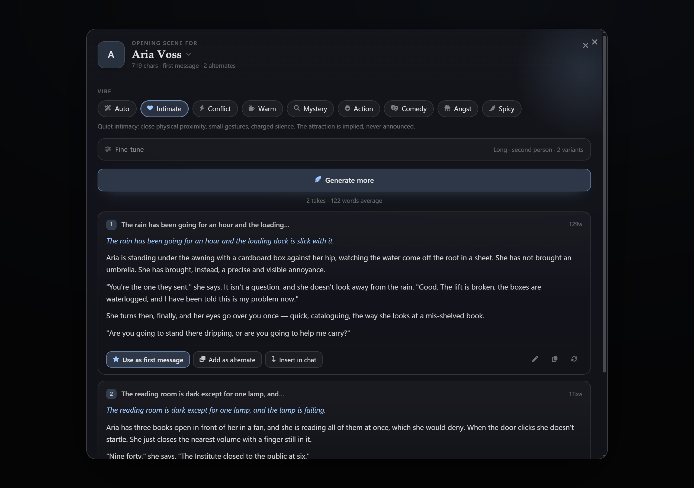
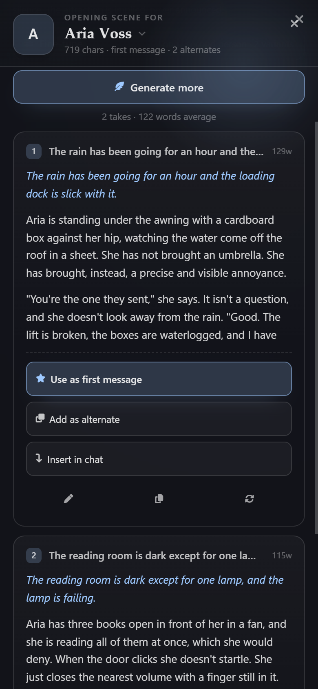
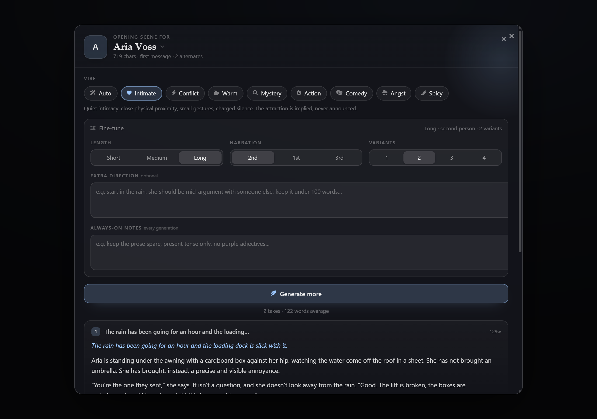
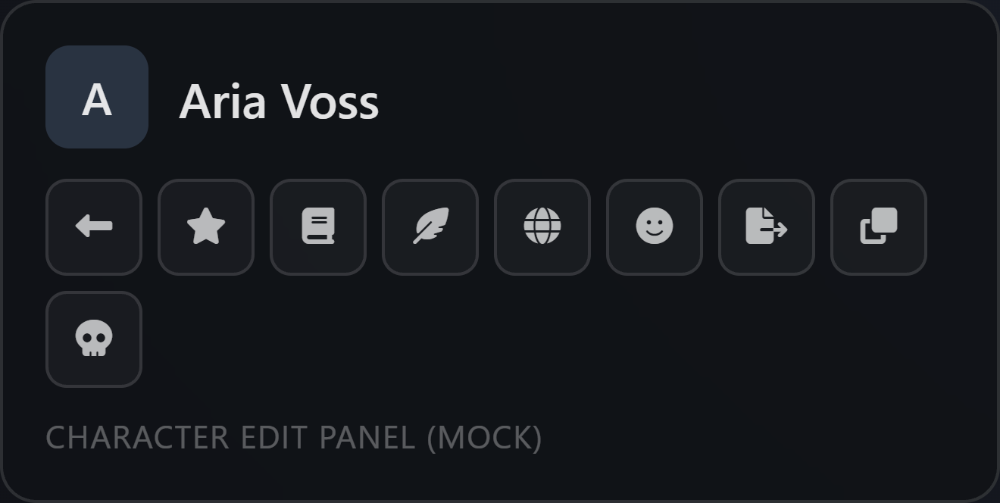

<div align="center">

# Opening Scenes

**A SillyTavern extension that writes the opening message your character card deserves.**

Pick a vibe. Get a few takes. Keep the one that lands.

[](https://github.com/SillyTavern/SillyTavern)
[](https://github.com/HakaiGod420/st-opening-scenes/releases)
[](LICENSE)



</div>

---

## The problem

Every card in your library opens the same way: the character is waiting somewhere, they notice you, they say
something wry. It works exactly once. After that, every replay starts with the same first beat — and the alternate
greetings that shipped with the card are usually three more versions of it.

Asking the model in chat gives you *something*, but it writes it as a reply: in the shadow of the card's existing
greeting, using the current chat's history, in the voice of whatever character happens to be loaded. It rarely feels
like the beginning of a story. It feels like a paraphrase.

Opening Scenes does one job — it takes a card and writes new first messages that fit *that* card, then puts the one
you like where it belongs.

## What it does

- **Reads the card, not the chat.** Description, personality, scenario, example dialogue, tags, author notes and
  narration notes all go into the brief. Example dialogue sets the register: if the card speaks in clipped fragments,
  so does the opening.
- **Told to diverge.** The card's existing first message is handed to the model with an explicit instruction not to
  reuse its first line, its imagery or its structure. No paraphrases.
- **Nine vibes.** Or leave it on `Auto` and let the character decide what it most wants to be doing.
- **Takes, not a take.** Ask for 1–4 openings in one go — different place, different time of day, different first
  line — then choose.
- **Three places to put the winner.** Replace the card's first message, append it as an alternate greeting, or drop
  it into the open chat as a fresh message.
- **Editable before it lands.** Every take has an inline editor. Fix the last line, then apply.
- **Zero setup.** Runs on your active connection and its sampling presets. No extra key, no sidecar server, no
  "install this other extension first".

## Screenshots

| Generator | On a phone |
|---|---|
|  |  |

**Fine-tune** — length, narration, variants, per-run direction, and always-on style notes:



**Where you open it** — a feather beside Advanced Definitions in the character editor, one click from the card you are
working on:



## Install

**From the repo** — *Extensions* → *Install Extension* → paste:

```
https://github.com/HakaiGod420/st-opening-scenes
```

**Manual** — download [the zip](https://github.com/HakaiGod420/st-opening-scenes/releases/latest), unzip it, and drop
the `st-opening-scenes` folder into:

```
SillyTavern/public/scripts/extensions/third-party/
```

Then reload the SillyTavern page (not just the chat).

**Requirements:** SillyTavern 1.19 or newer and any working chat/text-completion connection. Written and verified
against 1.19.0; 1.13.4 exposes the same APIs, but is untested.

## Using it

Three ways in:

- the **wand menu** next to the chat input → *Opening Scenes*
- *Extensions* → *Opening Scenes* → **Open generator**
- the **feather button in the character editor**, beside Advanced Definitions (uses the card you are editing)

Then:

1. **Character** — preselects the one you are on; click the name to pick any card in your library.
2. **Vibe** — one click, one sentence of direction.
3. **Fine-tune** *(optional)* — the controls below.
4. **Generate** — takes appear with a title, a word count and their own action row.
5. **Apply** — *Use as first message*, *Add as alternate*, or *Insert in chat*. Close with the **X** or `Esc`.

### Vibes

| | Vibe | What the model is told to write |
|---|---|---|
| ✨ | **Auto** | Whatever suits this character best — specific and unexpected over a generic hello |
| ♥ | **Intimate** | Proximity, small gestures, charged silence; attraction implied, never announced |
| ⚡ | **Conflict** | Something is already wrong: friction, an accusation, a standoff |
| ☕ | **Warm** | Domesticity, easy familiarity, gentle humour, safety that feels earned |
| 🔍 | **Mystery** | Something is off; the character knows more than they are saying |
| 🔥 | **Action** | In motion from the first line — urgency, danger, a countdown already running |
| 🎭 | **Comedy** | The character's flaws become the joke; deadpan timing, escalating dignity loss |
| 🌧 | **Angst** | Aftermath, longing, guilt; restraint over melodrama |
| 🌶 | **Spicy** | Adult tension acknowledged but kept suggestive and in-character, fading before explicit |

### Fine-tune

| Control | Options | Notes |
|---|---|---|
| Length | Short · Medium · Long | ≈ 80–120 / 140–210 / 240–330 words |
| Narration | 2nd · 1st · 3rd person | Who tells it. The player is always "you"; the character is never voiced in your stead |
| Variants | 1–4 | Separate scenes, not rewrites of one scene |
| Extra direction | free text | Per run. *"Start in the rain, mid-argument with someone else"* |
| Always-on notes | free text | Applied to every generation, remembered between sessions |

## Slash command

```
/opening                          one opening for the character in the open chat
/opening vibe=conflict count=3    three takes, returned as text
/opening Aria length=short        a character by name
/opening insert=true              generate and drop it straight into the chat
```

Named arguments: `vibe`, `length`, `pov`, `count`, `direction`, `insert`.

## Safe by design

Card surgery is where extensions usually break someone's library. This one is conservative:

- **Partial writes only.** Updates go through SillyTavern's own `/api/characters/merge-attributes`, so the card is
  deep-merged and validated — never rebuilt from a form. Fields the extension does not touch stay exactly as they were.
- **Correct shape for both card specs.** V2 cards are written under `data.*`, V1 cards at the root, matching the way
  SillyTavern reads them back.
- **No surprise chat edits.** Replacing the first message also refreshes the greeting in the open chat — but only when
  that chat is untouched (just the greeting). Mid-roleplay, the card is updated and the chat is left alone.
- **No cross-character mistakes.** *Insert in chat* refuses unless the open chat belongs to the character you generated
  for, and a brand-new character blocks generation until it is saved.

## Which model call it uses

| Target | Call | Why |
|---|---|---|
| the character in the open chat | `generateQuietPrompt` | keeps the live card, world info and persona in context |
| any other character | `generateRaw` | a quiet prompt is injected into the prompt built from the *active* card, which would leak that card into the output |

Both respect your active connection and sampling presets, and both ask for prose separated by a `<<<SCENE>>>` sentinel
rather than JSON — long multi-paragraph strings are exactly where smaller models break escaping and lose the whole
batch. The parser is tolerant: numbered scenes, `---` dividers, a stray `Title:` line, wrapping quotes, leftover
reasoning blocks and trailing notes all get cleaned up, and a model that ignores the format entirely still yields one
usable scene.

## Development

The repo ships with a harness that boots the extension against stubbed SillyTavern internals — no SillyTavern
installation needed.

```bash
cd test
python serve.py          # -> http://127.0.0.1:8765/harness.html
```

`serve.py` rebuilds `test/mirror/` from the real sources on every start, so edits appear on reload. It also fakes
`/api/characters/merge-attributes` and appends every payload the extension sends to `test/last_merge.jsonl`, which is
how the card-write behaviour is verified: assert on the exact bytes that would hit the server.

Parser and prompt tests (plain node, no dependencies):

```bash
node test/parse.test.mjs
```

### Layout

```
manifest.json       SillyTavern extension manifest
index.js            boot, wand menu, settings panel, character-panel button, /opening
settings.html       drawer panel in Extensions settings
modal.html          generator markup
style.css           all UI styling, scoped to .os-popup / .os-app
src/prompt.js       vibe/length/pov definitions, prompt builder, tolerant output parser
src/generate.js     quiet-prompt vs raw-prompt generation
src/apply.js        card writes, chat insert, clipboard
src/modal.js        modal state and UI
src/store.js        persisted settings
test/               harness, stubs, parser tests, release helpers
```

## License

MIT — see [LICENSE](LICENSE).
